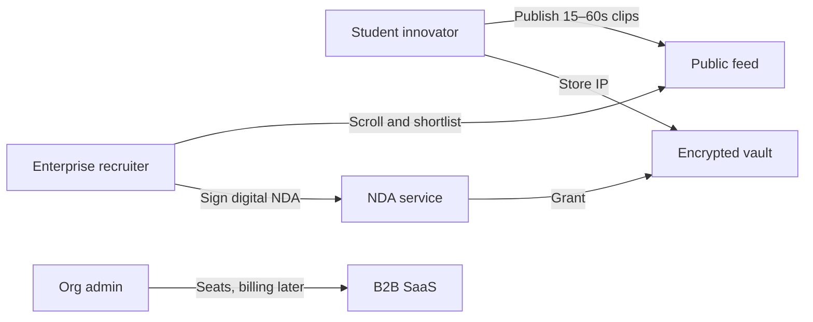
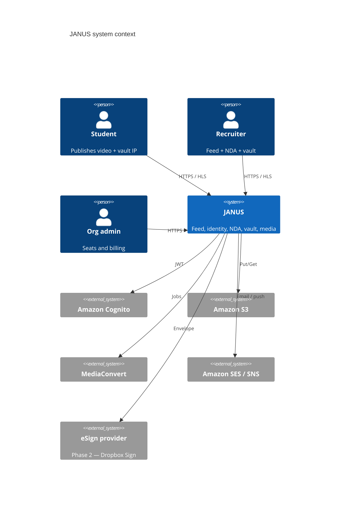
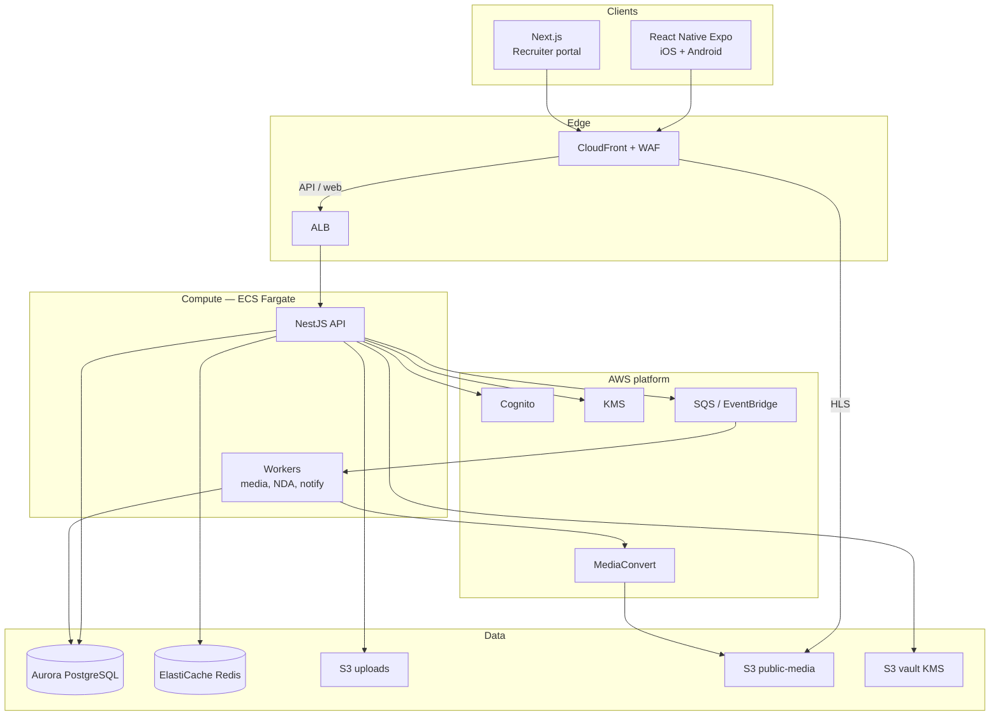
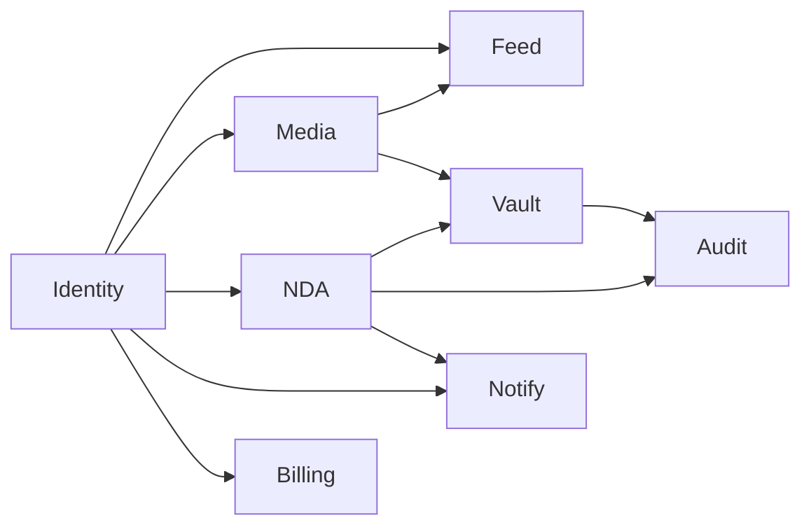
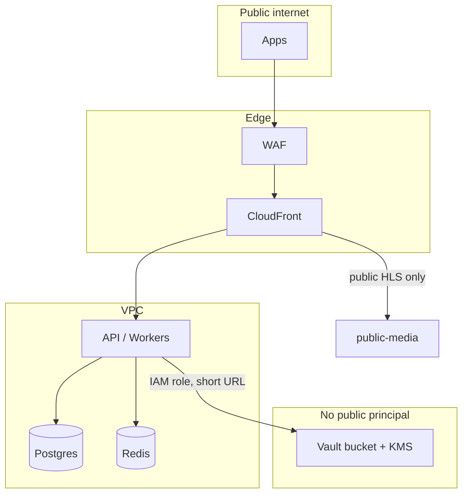

# JANUS High-Level Design

**Status:** Draft v1 — MVP architecture, scale path to 1M users  
**Region:** `ap-south-1`  
**Style:** Modular monolith (NestJS) behind CloudFront / ALB

---

## 1. Problem

Recruiters cannot judge student builders from a PDF resume. Students will not put real prototypes, CAD, or code on a public TikTok-style feed. JANUS splits the product into two planes:

| Plane | Audience | Content | Protection |
| --- | --- | --- | --- |
| **Public feed** | Anyone signed in | 9:16 watermarked HLS clips, profile, university | Visible watermark, no source files |
| **Vault** | Recruiter after NDA | Schematics, repos, high-res, CAD | KMS envelope encryption + signed URLs + forensic watermark + audit |

MVP utility is exactly those two planes: students upload, recruiters scroll, NDA unlocks the vault.

---

## 2. Users and jobs

| Actor | Job to be done |
| --- | --- |
| Student | Record/upload vertical video, attach vault files, control who can request NDA |
| Recruiter | Consume feed, request NDA, view vault, shortlist |
| Org admin | Manage seats (post-MVP), billing |
| Platform admin | Moderation, abuse, key rotation |

---

## 3. C4 — System context

---

## 4. C4 — Containers

The API never streams video. Clients play HLS from CloudFront. The API only mints grants and signed URLs.

---

## 5. Bounded contexts (NestJS modules)

Keep one deployable. Boundaries are modules + database schemas (or table prefixes), not separate repos.

| Context | Owns | Does not own |
| --- | --- | --- |
| **Identity** | Cognito mapping, profiles, orgs, roles | Feed ranking |
| **Media** | Upload tickets, transcode jobs, playback URLs | NDA legal state |
| **Feed** | Timeline, follows, likes, comments | Vault bytes |
| **Vault** | Encrypted objects, envelope keys, grants | User passwords |
| **NDA** | Templates, requests, signatures, legal hash | Transcoding |
| **Notify** | In-app, push, email | Business rules |
| **Billing** | Plans, seats, 5% deal fee (post-MVP) | Feed |
| **Audit** | Append-only access log | Mutations of content |

---

## 6. AWS reference topology

| Resource | Purpose | MVP size |
| --- | --- | --- |
| Route 53 | `api.janus.app`, `app.janus.app`, `cdn.janus.app` | 1 hosted zone |
| CloudFront | Web, API cache (GET only), HLS | 2 distributions |
| AWS WAF | Rate limit, bot, geo if needed | API + CDN |
| ALB | ECS target groups: api, workers | 1 ALB, 2 TGs |
| ECS Fargate | NestJS API (min 2 tasks, multi-AZ) | 0.5–1 vCPU |
| ECS Fargate | Workers (scale on SQS depth) | 0.25–1 vCPU |
| Aurora PostgreSQL | Source of truth | Serverless v2, 0.5–2 ACU |
| RDS Proxy | Connection pooling for bursty RN clients | Required before 10k DAU |
| ElastiCache Redis | Feed cache, rate limit, locks | cache.t4g.small |
| S3 `janus-uploads` | Presigned PUT, private | Versioning on |
| S3 `janus-public-media` | HLS + thumbs, CF OAC only | Lifecycle to IA |
| S3 `janus-vault` | KMS-CMK, no public, no CF except signed | Object Lock later |
| MediaConvert | HLS 540/720/1080 + watermark | On-demand queue |
| KMS | Platform CMK + per-asset data keys | Automatic rotation |
| Cognito | User pools, groups | Email + Google later |
| SES + Pinpoint/SNS | Transactional mail, push | Sandbox → production |
| Secrets Manager | DB, JWT, eSign keys | — |
| CloudWatch + X-Ray | Logs, traces, alarms | — |

All stateful stores stay in `ap-south-1`. CloudFront is global.

---

## 7. Trust boundaries

- Apps authenticate with Cognito JWTs.
- Vault bucket policy: only the API task role and a break-glass admin role.
- Public media: CloudFront OAC; S3 blocks public ACLs.
- Workers have no inbound load balancer.

---

## 8. Content classes

| Class | Examples | Storage | CDN | Watermark |
| --- | --- | --- | --- | --- |
| A — Public video | Feed clips | `public-media` | Yes, unsigned or cookie | Visible overlay |
| B — Public stills | Avatars, thumbs | `public-media` | Yes | Optional |
| C — Vault media | High-res, walkthrough | `vault` + KMS | Signed, 5–15 min | Visible + forensic per viewer |
| D — Vault files | PDF, STEP, zip | `vault` + KMS | Presigned GET, 5 min | Download filename + audit |
| E — NDA artifacts | Signed PDF, hash | `vault` or legal bucket | Never public | Checksum in Postgres |

Class A is what the TikTok-style feed plays. Classes C–E never appear in the feed player.

---

## 9. High-level request paths

**Feed play:** Client → CloudFront (HLS) → S3 public-media. API used only to fetch video ids and captions.

**Upload:** Client asks API for presigned PUT → S3 uploads → S3 event → SQS → worker → MediaConvert → public-media → Postgres `READY`.

**NDA unlock:** Recruiter signs → NDA module writes agreement + grant → Vault module mints CloudFront signed URL / cookie → client streams C/D → Audit row.

---

## 10. What we explicitly do not do in MVP

- Microservices, Kubernetes, Kafka
- On-device E2E encryption that the server cannot grant (breaks recruiter web + watermarking)
- Full DRM (FairPlay / Widevine) — Phase 2 if leakage is proven
- TikTok-grade ranking ML — recency + engagement + university affinity
- Marketplace payments / 5% fee — schema ready, product later
- Flutter — React Native is the single mobile stack

---

## 11. Success metrics for the architecture

| Signal | MVP target | 1M-user target |
| --- | --- | --- |
| API p95 (non-video) | < 200 ms | < 150 ms |
| Feed start (time-to-first-frame) | < 1.5 s on 4G | < 1.0 s |
| Upload to playable HLS | < 8 min for 60s 1080p | < 4 min |
| Vault grant mint | < 300 ms | < 200 ms |
| RPO / RTO | Daily snapshot / 4 h | PITR 5 min / 30 min |
