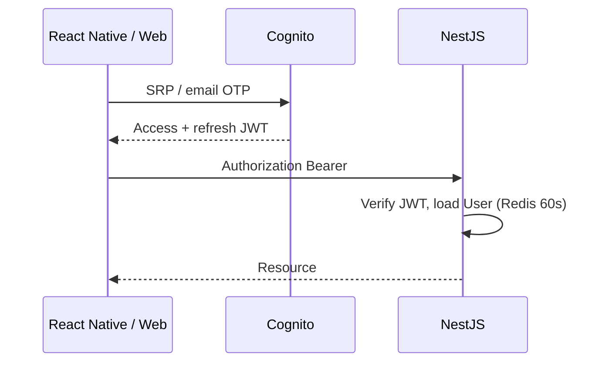
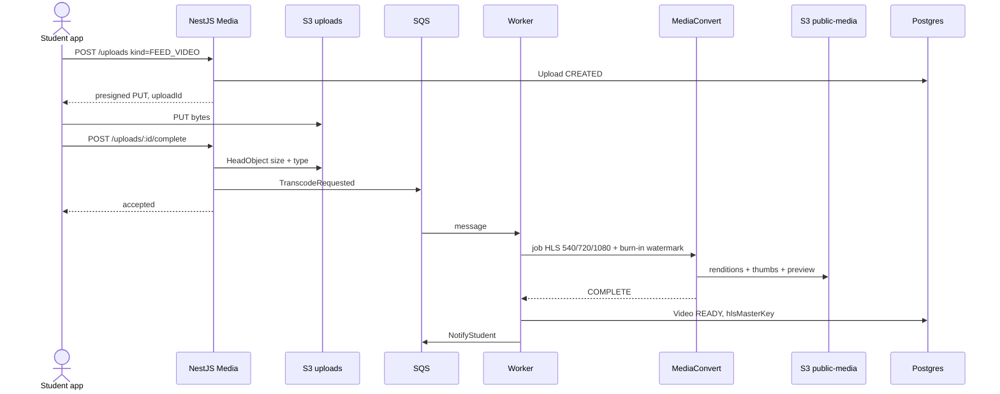
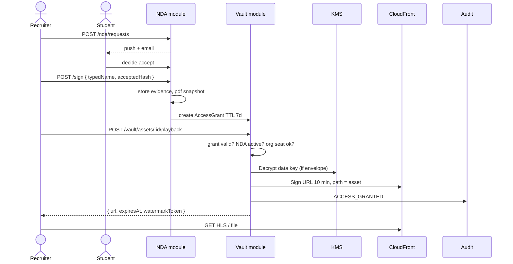

# JANUS Low-Level Design

This document specifies module internals, APIs, and the three critical sequences: **upload**, **feed**, **NDA → vault**.

---

## 1. NestJS application shape

```
apps/api/src
  /identity     AuthGuard, profiles, orgs
  /media        Upload tickets, playback, MediaConvert callbacks
  /feed         Timeline, social graph, ranking
  /vault        Envelope crypto, grants, signed URLs
  /nda          Templates, requests, signatures
  /notify       Outbox consumer
  /billing      Stub until monetization
  /audit        Append-only writer (no updates)
  /common       Prisma, Redis, SQS, config, filters
```

**Rules**

- One Prisma client, one database.
- Modules talk through Nest providers, not HTTP-to-self.
- Side effects go through an **outbox table** + worker (NDA signed → email, transcode done → notify).
- Controllers are thin. Domain logic lives in `*Service`.
- All public routes: `AuthGuard` + `RolesGuard`. Vault routes also: `GrantGuard`.

**API versioning:** `/v1/...`  
**IDs:** `cuid()` strings, never sequential integers on public APIs.

---

## 2. Auth and session



| Token | TTL | Stored |
| --- | --- | --- |
| Access | 15 min | Memory |
| Refresh | 30 days | SecureStore / httpOnly cookie (web) |
| Vault grant | 10 min | Redis, keyed by `userId:assetId` |

Cognito groups: `STUDENT`, `RECRUITER`, `ORG_ADMIN`, `PLATFORM_ADMIN`.  
Postgres `User` is the source of product fields; `cognitoSub` is unique.

Device sessions: table `DeviceSession` for revoke-all on password change.

---

## 3. REST surface (MVP)

Base: `https://api.janus.app/v1`

### Identity

| Method | Path | Role | Notes |
| --- | --- | --- | --- |
| POST | `/me/profile` | any | Upsert student or recruiter profile |
| GET | `/users/:id` | any | Public card; vault flags only |
| GET | `/orgs/:id` | recruiter | Org metadata |

### Media

| Method | Path | Role | Notes |
| --- | --- | --- | --- |
| POST | `/uploads` | student | Returns presigned POST/PUT + `uploadId` |
| POST | `/uploads/:id/complete` | student | Validates object, enqueues transcode |
| GET | `/videos/:id` | any | Metadata + public HLS URL if READY |
| DELETE | `/videos/:id` | owner | Soft delete, CF invalidation |

`POST /uploads` body:

```json
{
  "kind": "FEED_VIDEO" | "VAULT_FILE" | "VAULT_VIDEO",
  "contentType": "video/mp4",
  "byteSize": 48200192,
  "sha256": "optional-client-hash",
  "durationMs": 24000
}
```

Limits (enforced API + S3): feed video ≤ 90s, ≤ 200 MB; vault file ≤ 500 MB.

### Feed

| Method | Path | Role |
| --- | --- | --- |
| GET | `/feed?cursor=&limit=` | any |
| POST | `/videos/:id/like` | any |
| POST | `/videos/:id/comments` | any |
| POST | `/users/:id/follow` | any |
| GET | `/users/:id/videos` | any |

Cursor is `createdAt_id` opaque base64, not offset pages.

### NDA + vault

| Method | Path | Role | Notes |
| --- | --- | --- | --- |
| GET | `/nda/templates/default` | recruiter | Current legal text + hash |
| POST | `/nda/requests` | recruiter | `{ studentId, videoId?, reason }` |
| POST | `/nda/requests/:id/decide` | student | `{ accept: true }` or reject |
| POST | `/nda/requests/:id/sign` | recruiter | After accept; captures evidence |
| GET | `/vault/students/:id` | recruiter | List metadata if grant exists |
| POST | `/vault/assets/:id/playback` | recruiter | Mints signed URL, writes audit |

Idempotency: `Idempotency-Key` header on all POST that create money or legal state.

---

## 4. Sequence — feed video upload



**MediaConvert output groups**

- HLS: 540p 1.5 Mbps, 720p 3 Mbps, 1080p 5 Mbps, GOP 2s, AAC 128k
- Poster: 1080×1920 JPEG at 1s
- Preview: 3s muted MP4 for feed scrubbing
- Visible watermark: `JANUS · @handle` bottom-right, 4% height, 70% opacity

Failed jobs: SQS retry 3×, then `Video.status = FAILED` + student notify.

---

## 5. Sequence — NDA and vault playback



**Grant checks (all must pass)**

1. Recruiter `userId` matches grant  
2. `agreement.status = SIGNED` and not revoked  
3. `now < grant.expiresAt`  
4. Asset belongs to that student  
5. Org not suspended  
6. Rate: ≤ 30 vault opens / recruiter / hour  

On failure: `403` with stable code `VAULT_DENIED`, audit `ACCESS_DENIED`.

---

## 6. Feed ranking (MVP, deterministic)

Score for a candidate video:

```
score = 0.45 * recencyDecay(createdAt, halfLife=18h)
      + 0.25 * engagement (likes+comments+saves, log1p, 24h window)
      + 0.15 * followBoost (1 if following author)
      + 0.10 * universityMatch
      + 0.05 * completeness (has vault attached)
```

**Serving**

1. Redis `feed:{userId}` list, 200 ids, TTL 90s  
2. Miss → SQL: last 7 days READY videos, exclude seen (`FeedImpression` last 48h), compute score in worker or SQL  
3. Client `GET /feed?cursor=` returns 10 cards: video meta + author + HLS URL + `hasVault` boolean  

At 1M users this becomes a dedicated ranker + candidate generator (see scale doc). For MVP, in-process scoring on a cached candidate set is enough.

---

## 7. Workers and queues

| Queue | Producer | Consumer | Idempotency |
| --- | --- | --- | --- |
| `media.transcode` | Media complete | Transcode worker | `uploadId` |
| `media.callbacks` | EventBridge MediaConvert | Status worker | `jobId` |
| `nda.lifecycle` | NDA service | Notify + grant | `requestId` |
| `notify.send` | Outbox poller | Email/push | `outboxId` |
| `audit.hot` | Vault (sync write preferred) | Optional ship to S3 | `eventId` |

Pattern: transactional outbox. Business transaction writes `OutboxEvent`; poller publishes to SQS.

---

## 8. Caching

| Key | TTL | Invalidate |
| --- | --- | --- |
| `user:{id}` | 60s | Profile update |
| `video:{id}` | 30s | Status change |
| `feed:{userId}` | 90s | Upload READY, follow |
| `grant:{userId}:{assetId}` | grant TTL | Revoke NDA |
| `ratelimit:{userId}:{route}` | sliding 1m | — |

Cache stampede: Redis lock `lock:feed:{userId}` 2s.

---

## 9. Error contract

```json
{
  "error": {
    "code": "VAULT_DENIED",
    "message": "No active NDA grant for this asset",
    "requestId": "01J..."
  }
}
```

HTTP mapping: 400 validation, 401 missing/expired JWT, 403 grants/roles, 404, 409 NDA already signed, 429, 500.  
`requestId` = ALB + Nest CLS, returned to clients for support.

---

## 10. Observability hooks

- OpenTelemetry traces on every HTTP + Prisma + SQS
- Metrics: `http_request_duration`, `transcode_seconds`, `vault_grant_total{result}`, `feed_build_ms`
- Alerts: 5xx > 1%, p95 > 400ms, DLQ depth > 0, MediaConvert fail > 5%, Aurora ACU > 80%

---

## 11. Recruiter web LLD (Next.js)

| Route | Rendering | Data |
| --- | --- | --- |
| `/login` | Static | Cognito hosted UI or Amplify |
| `/feed` | Client | Same `/v1/feed` as mobile |
| `/nda/:requestId` | Client | Template + sign pad |
| `/vault/:studentId` | Client | Grant-gated list + HLS player |
| `/org` | Server | Seats (later) |

NDA signing must run in the browser so we capture typed name, IP (via API), user-agent, and document hash. PDF snapshot generated server-side with `pdf-lib` after sign.

Mobile uses the same API; web does not get a special backdoor into the vault.
