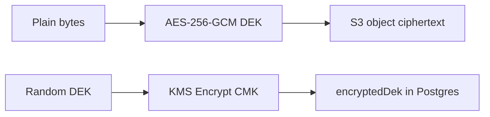

# JANUS Security & Encryption Wall

The encryption wall is the product differentiator. Treat it as a **control plane** (NDA + grants + audit) plus a **data plane** (KMS + S3 + short-lived CDN). Do not invent a custom cipher.

---

## 1. Threat model (MVP)

| Threat | Mitigation |
| --- | --- |
| Recruiter shares a public feed link | Feed is watermarked; source IP is not on the feed |
| Recruiter screenshots vault video | Forensic + visible per-session watermark; legal NDA; cannot prevent cameras |
| Recruiter re-uploads vault file | Audit + NDA; watermarked PDF/video; hash registry later |
| Stolen API token | 15 min access JWT, refresh rotation, vault grant separate and short |
| Presigned URL leak | 5–10 min TTL, path-bound, CloudFront signed, single-asset |
| Insider (employee) | Vault bucket no console list for devs; break-glass role + CloudTrail |
| Ransomware on S3 | Versioning + Object Lock (governance) on vault in Phase 2 |
| Account takeover | Cognito MFA (Phase 1.5), device revoke |
| Enumerate vault | List endpoints require grant; 404 vs 403 uniform `VAULT_DENIED` |

We accept: determined humans with cameras. We do not accept: casual link forwarding of source CAD/code.

---

## 2. Encryption design — envelope

1. Worker or API generates a 256-bit DEK.
2. Encrypt object with AES-256-GCM, random IV, AAD = `assetId`.
3. `kms:Encrypt` DEK with platform CMK `alias/janus-vault`.
4. Store `encryptedDek`, `iv`, `authTag` (or store IV/tag in object header).
5. S3 bucket default encryption: SSE-KMS with the same CMK (second wrap).

**Decrypt path:** only the API task role may `kms:Decrypt`. Clients never see the DEK. API decrypts to a streaming pipeline **or** (simpler MVP) stores S3 objects as SSE-KMS only and skips app-level AES if operational cost is too high.

**MVP recommendation (ship first):** SSE-KMS on `janus-vault` + IAM + signed URLs.  
**Phase 1.5:** application envelope encryption so a leaked S3 object without KMS is useless even to an IAM principal that was over-permissioned for GetObject-only mistakes.

Do not do client-side E2E where JANUS cannot decrypt: recruiters on web cannot play, and forensic watermarking cannot be applied per viewer.

---

## 3. Key management

| Key | Use | Rotation |
| --- | --- | --- |
| Cognito / JWT | Auth | Cognito managed |
| Aurora | At rest | AWS default |
| Redis AUTH | Cache | Secrets Manager 30d |
| CMK `janus-vault` | Vault DEKs | Auto yearly; re-encrypt DEKs on compromise |
| CloudFront signing key | Vault URLs | Dual keys, rotate 90d |
| MediaConvert IAM | Transcode | Least privilege |

CMK key policy: account root + API task role + worker role. No human users in key policy. Engineers use SSO + break-glass.

---

## 4. Watermarking

| Layer | Where | Content |
| --- | --- | --- |
| Visible feed | MediaConvert burn-in | `JANUS · @handle` |
| Visible vault | On-the-fly or pre-render | Recruiter email hash + org + date |
| Forensic | Optional overlay ID in corner in 8pt | `grantId` short code |
| File | PDF footer stamp on download | Agreement id |

**Per-viewer video watermark** requires either:

- A. Unique HLS package per grant (expensive, strongest), or  
- B. Player-side overlay (weak, spoofable), or  
- C. Periodic unique segment rewrite (complex)

MVP: **A for vault videos under 3 minutes** if volume is low; else **B + legal NDA** until volume justifies a watermark service (e.g. AWS or vendor). Never skip visible watermark on vault.

---

## 5. Digital NDA — legal + technical

### Phase 1 (MVP, India-first)

Electronic signature under the Information Technology Act, 2000: intent + association + integrity.

Capture:

- Template version id + SHA-256 of exact bytes shown
- Typed full name + checkbox “I agree”
- UTC timestamp
- Source IP (ALB `x-forwarded-for` last trusted)
- User-Agent + app version + device id
- Server-generated PDF snapshot stored in vault bucket
- `NdaAgreement` row immutable

Student **accepts request** (they control IP). Recruiter **signs** (they assume duty). Both actions logged.

### Phase 2

Dropbox Sign / DocuSign for enterprise procurement teams who require vendor eSign. Store `providerEnvelopeId` on the same agreement row. Product flow unchanged.

### Revocation

Student or platform sets `revokedAt` on grant + agreement. Subsequent playback returns `VAULT_DENIED`. CloudFront signed URLs die at TTL (≤ 10 min), so revocation is “soon,” not instant worldwide — document this.

---

## 6. Access control matrix

| Resource | Student owner | Other student | Recruiter no NDA | Recruiter with grant | Admin |
| --- | --- | --- | --- | --- | --- |
| Feed video meta | RW | R | R | R | RW |
| Feed HLS | R | R | R | R | R |
| Vault list | R | — | — | R | R |
| Vault bytes | R | — | — | R time-boxed | break-glass |
| NDA request | Decide | — | Create | — | Moderate |

`GrantGuard` runs after `RolesGuard`. Never authorize vault by “recruiter role” alone.

---

## 7. Signed delivery

**Files:** S3 presigned GET, 5 minutes, `ResponseContentDisposition` filename stamped.

**HLS:** CloudFront signed URL or signed cookies on `/vault/{assetId}/*`. Cookie is better for playlists + segments. TTL 10 minutes; player calls `POST /playback` again on 403.

Key pair lives in Secrets Manager. Signer is NestJS Vault service only.

---

## 8. Application security baseline

- TLS 1.2+ everywhere; HSTS on web
- WAF: rate limit per IP + JWT subject, SQLi/XSS managed rules
- CORS: only `app.janus.app` and Expo dev
- Helmet, ValidationPipe whitelist, payload 1 MB JSON (uploads are S3)
- Prisma parameterized only; no raw SQL in modules except Audit if needed
- Secrets never in images; IAM task roles
- Dependabot + `npm audit` in CI
- Pentest before first enterprise NDA in production

---

## 9. Privacy (DPDP Act, 2023)

| Data | Lawful use | Retention |
| --- | --- | --- |
| Email, name | Account | Until deletion |
| University | Profile | Until deletion |
| Video | Product | Until deletion + 30d backup |
| NDA evidence | Legal | 7 years (contract) |
| Audit vault access | Security | 2 years hot, 5 years cold |
| IP address on sign | Legal evidence | With agreement |

Region lock: primary data `ap-south-1`. CloudFront access logs may be global; keep logs in Mumbai bucket. Student deletion: anonymize profile, tombstone videos, **retain NDA PDFs** (legal hold) with actor id hashed.

---

## 10. Abuse and moderation

- Report video / user
- Hash-match CSAM via standard provider before public READY (non-negotiable for UGC)
- Rate limits on upload, comment, NDA request (e.g. 10 NDA/day/recruiter in MVP)
- Shadow-hide without notifying attacker on spam

---

## 11. What “secure streaming” actually means here

Clean vertical playback is **HLS + CDN + correct player**, not encryption. Encryption is for the vault. Mixing them causes a slow feed.

| Goal | Mechanism |
| --- | --- |
| Smooth public 9:16 | MediaConvert HLS, CloudFront, `react-native-video` / ExoPlayer / AVPlayer |
| Protect IP | NDA + KMS + signed URLs + watermark + audit |
| Scale | Bytes off origin; API stateless |

If a vendor pitches “encrypted TikTok,” split the sentence: encrypt the vault; CDN the feed.
