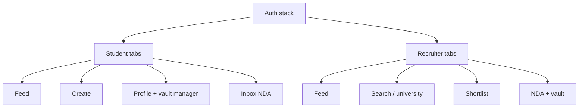

# JANUS Clients — React Native and Web

MVP clients: **one Expo app** (iOS + Android) for students and recruiters, plus a **Next.js recruiter portal** for NDA signing and vault review on desktop (enterprises will insist on a browser).

Flutter is not in scope. React Native shares TypeScript with NestJS and Next.js, which matters more than widget catalogs at this stage.

---

## 1. Why React Native (Expo)

| Need | Expo / RN |
| --- | --- |
| Vertical feed, 60 fps | FlashList + `react-native-video` (AVPlayer / ExoPlayer HLS) |
| Camera + upload | `expo-camera`, `expo-image-picker`, presigned S3 |
| iOS + Android from day one | One codebase |
| OTA hotfixes | EAS Update (JS-only) |
| Hire in Bengaluru | Large RN + TS pool |

Use **Expo SDK + Expo Router + EAS Build**. Bare workflow only if a native watermark SDK appears later.

---

## 2. App information architecture



Role is claimed at onboarding (cannot hold both without a second account in MVP).

**Student Create flow:** Record 9:16 or pick from camera roll → trim 15–60s → caption → optional attach vault files → upload.

**Recruiter vault flow:** Feed card “IP locked” → Request NDA → wait → Sign on web or in-app WebView/screen → Player with watermark.

---

## 3. Mobile module map

```
apps/mobile
  app/                 Expo Router
    (auth)/
    (student)/
    (recruiter)/
  src/api/             OpenAPI client, Zod
  src/auth/            Cognito / Amplify
  src/feed/            Player, prefetch, gestures
  src/upload/          Chunked PUT, background
  src/vault/           Grant refresh, secure viewer
  src/nda/
```

**State:** TanStack Query for server; Zustand for ephemeral player/UI. No Redux.

**Auth tokens:** `expo-secure-store`. Never AsyncStorage.

---

## 4. Vertical player (the hard UI)

| Rule | Implementation |
| --- | --- |
| One video in memory above/below | Windowed FlashList, `extraData` none |
| HLS | `react-native-video` with `preferExternalPlayback: false` |
| Mute default | Unmute on tap; persist preference |
| Prefetch | Next item `source` mounted paused |
| Captions | Overlay, not baked, so copy can change |
| 9:16 letterbox | Never stretch; black bars on iPad |
| Analytics | `onProgress` sampled 1s → impression API batched |

Public feed uses **unsigned** CloudFront URLs (or signed cookies at distribution level for hotlink resistance). Vault player uses cookies from `/playback` and **must not** write HLS to the photo library.

Disable screen recording on vault screens: iOS `UIScreen.captured`, Android FLAG_SECURE. This is a deterrent, not a guarantee.

---

## 5. Upload (mobile)

1. Probe duration/aspect; reject if not 9:16 ± 5% or duration out of range.
2. Optional client compress (ffmpeg-kit or Expo video) to 1080×1920 ≤ 12 Mbps — saves MediaConvert cost.
3. `POST /uploads` → PUT to S3. Use multipart if > 16 MB.
4. Background: `expo-file-system` upload tasks so the user can leave the screen.
5. Progress UI from bytes sent; READY comes via push or poll `GET /videos/:id`.

Vault files: same ticket with `kind=VAULT_FILE`. No client-side compression of CAD/zip.

---

## 6. Offline and performance

| Concern | Approach |
| --- | --- |
| Feed offline | Last 20 cards in MMKV; video not stored |
| Slow 4G | Start 540p HLS; player ABR up |
| App size | Expo; avoid unused native modules |
| Startup | Auth hydrate → feed query parallel |
| List jank | No JS work on scroll; Reanimated for chrome |

---

## 7. Recruiter web (Next.js)

Desktop is where NDAs and CAD PDFs actually get read.

| Screen | Notes |
| --- | --- |
| Feed | CSS scroll-snap 9:16 column, max-width 420px centered |
| NDA | Full template, scroll-to-bottom required, typed name, hash shown |
| Vault | PDF.js for documents; HLS.js for vault video; download button audited |
| Org | Placeholder |

Auth: Cognito Hosted UI in production; local HS256 via Nest `POST /v1/dev/tokens`. Session: httpOnly cookies (`janus_session` + `janus_claims` for silent remint). Server Components and Server Actions call Nest with the cookie — the JWT never sits in `localStorage`. Signed vault URLs may reach the browser for HLS/PDF only after an audited `POST /v1/vault/assets/:id/playback`.

---

## 8. Shared contract

Generate TypeScript types from NestJS (OpenAPI) into `packages/api-types`. Both Expo and Next.js import the same Zod schemas for feed cards and NDA payloads. Breaking the contract in one client is a CI fail.

---

## 9. iOS / Android specifics

| Topic | iOS | Android |
| --- | --- | --- |
| Video | AVPlayer HLS | ExoPlayer HLS |
| Push | APNs via SNS or Expo | FCM |
| Background upload | URLSession | WorkManager via Expo |
| FLAG_SECURE / capture | Yes on vault | Yes on vault |
| Store | TestFlight / App Store | Play Internal testing |

Privacy nutrition / Data safety: video UGC, NDA PII. Fill questionnaires before store submit.

---

## 10. UX quality bar (MVP)

- Feed: thumb-first, caption last, no chrome except like/NDA
- Create: 4 steps max
- NDA: readable legal, not a dark-pattern checkbox
- Empty states: “No requests” / “Processing video”
- Errors: map `VAULT_DENIED` to “Sign NDA to view this prototype”

This is the “TikTok feel.” The LinkedIn feel is the recruiter web vault and org context — do not clutter the student feed with enterprise UI.
