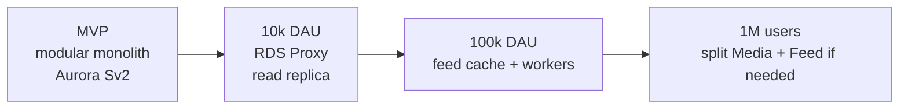
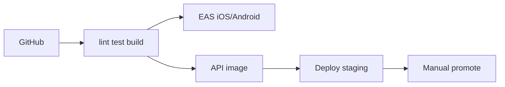

# JANUS Scalability and Operations

Design for **1 million registered users**, not 1 million concurrent live viewers. Those are different systems. TikTok-scale live concurrency is out of scope; a large UGC marketplace in India is in scope.

Assumptions for capacity:

| Metric | Conservative 1M-user year |
| --- | --- |
| MAU | 250k–400k |
| DAU | 40k–80k |
| Peak concurrent API | 3k–8k |
| Videos uploaded / day | 5k–20k |
| Avg bitrate HLS | ~3 Mbps viewing |
| NDA signs / day | hundreds, not millions |

Video bits dominate cost and architecture. The API stays small if CloudFront does its job.

---

## 1. Scale path (do not skip rungs)

| Rung | When | Change |
| --- | --- | --- |
| 0 | Pre-seed MVP | 2× API tasks, 1× worker, Aurora Serverless v2, Redis small, 3 buckets |
| 1 | p95 rising or connection errors | RDS Proxy, API autoscaling 2–8, Redis larger, CF cache headers |
| 2 | Feed SQL > 40% CPU | Materialized candidate sets, replica for reads, impression TTL |
| 3 | MediaConvert queue or feed module noisy-neighbor | Extract `media-worker` and `feed-read` services; keep NDA on monolith |

Microservices before rung 2 is wasted equity.

---

## 2. Capacity sketch (rung 2–3)

**API:** 8 Fargate tasks × 1 vCPU handle ~4–8k RPS of JSON if Redis hits. Feed JSON is tiny.

**Postgres:** Aurora 4–16 ACU. Primary writes (likes, impressions, NDA). Replica serves `GET /feed` and profiles. RDS Proxy caps sessions from RN reconnect storms.

**Redis:** Feed lists + rate limits. `r6g.large` is plenty at 80k DAU if values are ids not payloads.

**S3 / CloudFront:** 20k videos/day × 80 MB HLS ≈ 1.6 TB/day ingress. Egress is the bill — cache hit ratio target **> 90%** on popular rungs.

**MediaConvert:** Parallel jobs limited by queue. Burst: on-demand + reserved queue if monthly minutes explode.

**Vault:** Low QPS. CPU cost is KMS + signing, not bandwidth (compared to feed).

---

## 3. Feed at 1M users

MVP scoring in the API will die when the candidate set is “all videos in 7 days.”

**Next design:**

1. **Ingest:** on READY, write video id to Redis ZSET `global:recent` and `uni:{id}:recent`.
2. **Candidates:** union(following, university, global recent) cap 500.
3. **Filter:** seen ids (Redis SET `seen:{user}` 48h).
4. **Rank:** lightweight scorer (same formula) in worker every 90s per active user **or** at request for low-DAU.
5. **Store:** `feed:{userId}` list.

Personalization ML is a later ranker service swapping step 4.

---

## 4. Database hygiene

- RDS Proxy from day 1 if you expect demo traffic spikes
- `FeedImpression` partitioned by week or deleted after 14 days
- Likes: counter on `Video` updated async (Redis INCR → flusher) to avoid row hotspots
- Never store HLS playlists in Postgres
- `EXPLAIN` the feed query in CI against a 1M-row fixture

---

## 5. Multi-AZ and DR

| System | HA | Backup |
| --- | --- | --- |
| ECS | 2 AZs | Immutable images |
| Aurora | Multi-AZ | PITR 7d MVP → 35d later |
| Redis | Failover group | Cache only, no backup |
| S3 | 11 nines | Versioning on vault + uploads |
| Cognito | AWS managed | — |

RTO 4h MVP (restore Aurora + redeploy). RPO: Aurora PITR. Chaos: do not run production only on one NAT.

---

## 6. Cost control (pre-seed)

| Lever | Effect |
| --- | --- |
| Client 1080p cap, 60s max | Transcode + storage |
| HLS 3-rung not 6 | Minutes billed |
| CloudFront + cache-control 1y on hashes | Egress |
| Glacier on old vault versions | Storage |
| Aurora Serverless min ACU 0.5 nights | Compute |
| MediaConvert only on complete, not on every PUT | Jobs |

Video CDN will exceed API cost by 10–50× at success. Price B2B SaaS accordingly.

---

## 7. SLOs

| SLO | Target | Window |
| --- | --- | --- |
| API availability | 99.5% MVP / 99.9% paid | 30d |
| Feed TTFB | p95 < 200 ms | 7d |
| Time to first frame | p95 < 1.5 s (4G) | 7d |
| Transcode success | > 98% | 7d |
| Vault grant success | > 99.9% excluding 403 | 30d |

Error budget: freeze features if availability SLO burned.

---

## 8. CI/CD

- Staging account separate from prod
- Prisma migrate in CI against staging; prod migrate gated
- Feature flags (Flagsmith or Config) for NDA provider switch
- Mobile: EAS Submit after TestFlight smoke

---

## 9. Load test before calling it “1M ready”

Use k6 against staging:

1. `GET /feed` 2k RPS  
2. `POST /likes` 200 RPS  
3. Presigned upload 50 RPS (mock S3)  
4. `POST /playback` 20 RPS with grants  

Pass criteria: p95, error rate, Aurora CPU, Redis evictions. Do this before enterprise pilots, not after.
